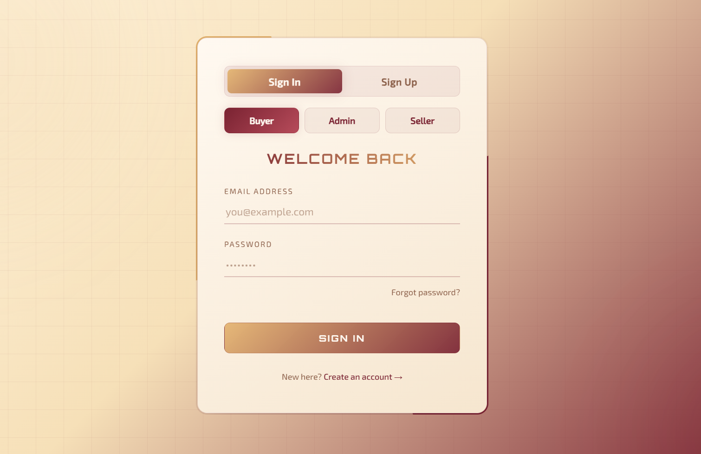
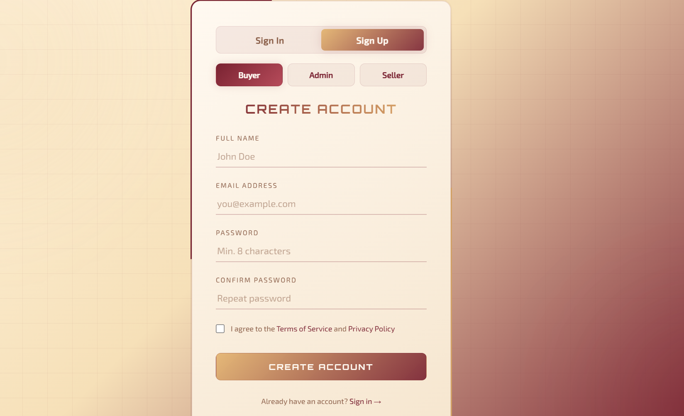

# Modern Login Flow — Refined Boutique Aesthetic

A modern, boutique-inspired login and sign-up interface built with HTML, CSS, and vanilla JavaScript. The project combines elegant gradients, animated borders, and interactive account selection to create a distinctive authentication UI.

## Preview

### Sign In



### Sign Up



## Features

- **Sign In and Sign Up:** Switch between login and registration panels.
- **Role Selection:** Choose between Buyer, Admin, and Seller.
- **Animated Borders:** Rotating gradient effects around the main form card.
- **Dynamic Background:** Softly animated background elements and gradient colors.
- **Modern Form Styling:** Custom input fields, focus effects, and interactive buttons.
- **Registration Form:** Includes name, email, password, password confirmation, and a terms agreement checkbox.
- **Custom Color Palette:** Cream, sand, burgundy, and rose tones for a refined visual identity.
- **Typography:** Google Fonts integration using Orbitron and Exo 2.
- **Lightweight Implementation:** Built with standard web technologies without requiring a JavaScript framework.

## Tech Stack

| Technology | Usage |
|---|---|
| HTML5 | Page structure and form elements |
| CSS3 | Layout, gradients, animations, and transitions |
| Vanilla JavaScript | Tab switching and role selection |
| Google Fonts | Orbitron and Exo 2 typography |

## Project Structure

```text
Modern-login-flow-with-a-refined-boutique-aesthetic/
├── login.html
├── login.css
├── login-preview.png
├── signup-preview.png
└── README.md
```

- `login.html` — Contains the sign-in and sign-up interfaces and JavaScript interactions.
- `login.css` — Defines the layout, color palette, animations, and visual effects.
- `login-preview.png` — Screenshot of the sign-in interface.
- `signup-preview.png` — Screenshot of the registration interface.
- `README.md` — Project documentation.

## Getting Started

### Prerequisites

- A modern web browser.
- Git (optional, for cloning the repository).
- Visual Studio Code or another code editor (optional).

### Installation

**1. Clone the repository**

```bash
git clone https://github.com/prasuna-99/Modern-login-flow-with-a-refined-boutique-aesthetic.git
```

**2. Navigate to the project directory**

```bash
cd Modern-login-flow-with-a-refined-boutique-aesthetic
```

**3. Launch the application**

Open `login.html` directly in your web browser.

Alternatively, open the project in Visual Studio Code and use the Live Server extension.

## Implementation Details

### Tab Navigation

The `switchTab()` JavaScript function controls the transition between the Sign In and Sign Up panels by updating their active CSS classes.

### Role Selection

The role selector uses JavaScript event listeners to update the active state of the Buyer, Admin, and Seller buttons, providing immediate visual feedback when a role is selected.

### Styling and Animations

The stylesheet uses CSS custom properties for consistent colors, keyframe animations for rotating borders and background movement, and transitions for interactive form elements.

### Design Approach

The interface combines a warm, boutique-inspired color palette with modern UI effects. Gradient borders, subtle background patterns, and carefully styled form elements create a polished visual experience.

## Future Enhancements

- Form validation and user-friendly error messages.
- Backend authentication and registration integration.
- Database integration for account management.
- Role-based authorization.
- Password visibility controls and password recovery.
- Accessibility improvements and reduced-motion support.

## Author

**Prasuna Shahi Dulal**

- GitHub: [@prasuna-99](https://github.com/prasuna-99)

## License

No license has been specified for this project yet.
